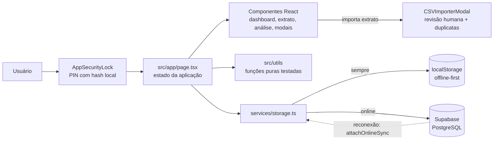

# Sistema de Gestão Financeira Pessoal

Aplicação web para controle financeiro pessoal manual — registro de receitas,
despesas e investimentos organizados por categorias ("nichos") com limite
mensal, histórico completo e análises baseadas em dados reais.

## Funcionalidades

- Registro manual de lançamentos (receita, despesa, investimento)
- Categorias personalizáveis com limite mensal e indicador de progresso
- Importação de extrato bancário via arquivo CSV ou Excel, com revisão antes
  de confirmar e detecção de possíveis duplicatas
- Análise financeira: comparação com meses anteriores, projeção de
  fechamento do mês corrente, taxa de poupança e evolução do saldo
  acumulado ao longo do tempo
- Sincronização entre dispositivos via Supabase, com funcionamento offline
  (dados salvos localmente e sincronizados quando a conexão retorna)
- Acesso protegido por PIN (hash local, sem senha em texto puro)
- Instalável como aplicativo (PWA) em celular ou desktop

## Stack técnica

- [Next.js 15](https://nextjs.org/) (App Router) + React 19 + TypeScript
- [Tailwind CSS](https://tailwindcss.com/) para estilização
- [Supabase](https://supabase.com/) (PostgreSQL) para persistência e sincronização
- `papaparse` e `xlsx` para importação de extratos
- Testes com o test runner nativo do Node.js (`node --test`)

## Arquitetura



Fluxo de um lançamento: o usuário salva no modal, o estado da página é
atualizado e gravado de imediato em `localStorage` (funciona offline); com
rede, `StorageService` faz `upsert` no Supabase e o indicador de
sincronização passa de `syncing` para `synced`. Ao reconectar,
`attachOnlineSync` reenvia o que ficou pendente. Cálculos e regras vivem em
`src/utils/`, sem depender de React (ver
[ADR 0005](docs/adr/0005-logica-pura-separada-para-testabilidade.md)).

## Pré-requisitos

- **Com Docker (recomendado):** Docker e Docker Compose. Não precisa de Node.
- **Sem Docker:** Node.js 22 ou superior e npm.

## Configuração das variáveis de ambiente

O Supabase é **opcional**. Sem as variáveis abaixo, o app funciona normalmente
salvando os dados só no navegador (`localStorage`). Para sincronizar entre
dispositivos:

1. Crie um projeto gratuito em https://app.supabase.com.
2. No SQL Editor do projeto, rode o conteúdo de `supabase_schema.sql`.
3. Em Project Settings → API, copie a URL e a chave anônima (*anon/publishable*).
4. Copie `.env.local.example` para `.env.local` e preencha:

| Variável | Descrição |
|---|---|
| `NEXT_PUBLIC_SUPABASE_URL` | URL do projeto Supabase |
| `NEXT_PUBLIC_SUPABASE_ANON_KEY` | Chave anônima do projeto (é pública por desenho; ver [ADR 0004](docs/adr/0004-pin-local-sem-autenticacao-de-servidor.md)) |

`.env.local` nunca é versionado.

## Rodando a aplicação

### Com Docker (comando único)

```bash
docker compose up --build
```

Abre em http://localhost:3000. Para usar o Supabase, exporte as duas variáveis
antes do comando (ou coloque-as num arquivo `.env` na raiz, que o Compose lê
sozinho). As variáveis `NEXT_PUBLIC_*` são passadas como `build.args` porque
precisam existir em tempo de build — ver
[ADR 0002](docs/adr/0002-supabase-backend.md).

### Sem Docker

```bash
npm ci
npm run dev
```

Abre em http://localhost:3000 (ou na porta indicada no terminal).

## Rodando os testes

### Com Docker (comando único)

```bash
docker compose run --rm test
```

Executa a suíte completa e imprime o relatório de cobertura.

### Sem Docker

```bash
npm run test            # suíte de testes
npm run test:coverage   # testes + relatório de cobertura
npm run typecheck       # checagem de tipos
```

## Scripts disponíveis

| Script | O que faz |
|---|---|
| `npm run dev` | Servidor de desenvolvimento |
| `npm run build` | Build de produção |
| `npm run test` | Testes unitários |
| `npm run test:coverage` | Testes com relatório de cobertura (módulos de `src/utils/`) |
| `npm run typecheck` | `tsc --noEmit` |

## Testes e cobertura

Suíte com 30 testes cobrindo a lógica de cálculo financeiro
(`src/utils/insights.ts`), o parser de importação de extrato
(`src/utils/csvXlsxParser.ts`), o hash de PIN (`src/utils/pin.ts`) e
formatação/saúde financeira (`src/utils/formatters.ts`), incluindo casos de
borda como comparação de tendência restrita a meses anteriores e projeção de
fechamento de mês.

| Módulo | Linhas | Ramos | Funções |
|---|---|---|---|
| `formatters.ts` | 98,56% | 95,12% | 100% |
| `insights.ts` | 97,56% | 85,71% | 100% |
| `pin.ts` | 100% | 100% | 100% |
| `csvXlsxParser.ts` | 79,49% | 70,00% | 82,14% |
| **Total** | **92,37%** | **83,96%** | **94,57%** |

O CI roda tipos, testes, cobertura e build a cada push e Pull Request.
Evidências salvas em [`docs/test-evidence/`](docs/test-evidence/).

## Versão e release

Versão atual: **1.0.0**. Histórico de mudanças em [`CHANGELOG.md`](CHANGELOG.md);
especificação como entregue em
[`docs/spec/ESPECIFICACAO-AS-BUILT.md`](docs/spec/ESPECIFICACAO-AS-BUILT.md).

## Documentação

Índice completo em [`docs/README.md`](docs/README.md) — comece por lá para
navegar por toda a documentação do projeto. Atalhos diretos:

- [`docs/spec/ESPECIFICACAO-AS-BUILT.md`](docs/spec/ESPECIFICACAO-AS-BUILT.md) — especificação definitiva (As-Built): arquitetura, contratos e limitações da v1.0.0.
- [`docs/spec/ESPECIFICACAO.md`](docs/spec/ESPECIFICACAO.md) — especificação
  técnica: requisitos funcionais/não funcionais, decomposição do sistema,
  modelo de dados e histórico de refinamento.
- [`docs/adr/`](docs/adr/README.md) — Architecture Decision Records: por que
  Next.js, por que Supabase, por que lançamento manual em vez de Open
  Finance, por que PIN local em vez de autenticação de servidor, por que a
  lógica de cálculo é isolada em módulos puros, e o que ficou fora de
  escopo conscientemente.
- [`CLAUDE.md`](CLAUDE.md) — contexto e regras para agentes de IA que
  trabalhem neste repositório (como o projeto foi construído com Claude
  Code, e o que qualquer sessão futura de agente deve respeitar).

## Fluxo de contribuição

- `main` — sempre estável/implantável. Não recebe commit direto.
- `develop` — branch de integração.
- `feature/<nome>` — uma branch por unidade de trabalho, criada a partir de
  `develop`.
- Mudanças chegam a `develop` (e periodicamente a `main`) via Pull Request
  com revisão antes do merge (o autor do PR revisa o próprio diff conforme o
  checklist do template; para exigir review de outro integrante, ative
  "Require approvals" na proteção da `main`).
- Decisão de arquitetura nova → registrar como ADR em `docs/adr/` junto da
  mudança, não depois.
