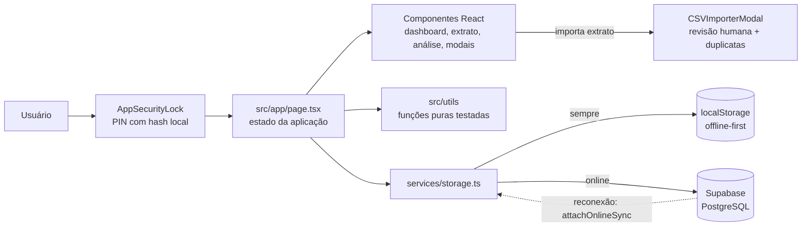

# Sistema de Gestão Financeira Pessoal

Aplicação web para controle financeiro pessoal manual — registro de receitas,
despesas e investimentos organizados por categorias ("nichos") com limite
mensal, histórico completo e análises baseadas em dados reais.

## Funcionalidades

- Registro manual de lançamentos (receita, despesa, investimento)
- Categorias personalizáveis com limite mensal e indicador de progresso
- Importação de extrato bancário via arquivo CSV ou Excel, com revisão antes
  de confirmar e detecção de possíveis duplicatas
- Análise financeira: comparação com meses anteriores, projeção de
  fechamento do mês corrente, taxa de poupança e evolução do saldo
  acumulado ao longo do tempo
- Sincronização entre dispositivos via Supabase, com funcionamento offline
  (dados salvos localmente e sincronizados quando a conexão retorna)
- Acesso protegido por PIN (hash local, sem senha em texto puro)
- Instalável como aplicativo (PWA) em celular ou desktop

## Stack técnica

- [Next.js 14](https://nextjs.org/) (App Router) + React 18 + TypeScript
- [Tailwind CSS](https://tailwindcss.com/) para estilização
- [Supabase](https://supabase.com/) (PostgreSQL) para persistência e sincronização
- `papaparse` e `xlsx` para importação de extratos
- Testes com o test runner nativo do Node.js (`node --test`)

## Arquitetura



Fluxo de um lançamento: o usuário salva no modal, o estado da página é
atualizado e gravado de imediato em `localStorage` (funciona offline); com
rede, `StorageService` faz `upsert` no Supabase e o indicador de
sincronização passa de `syncing` para `synced`. Ao reconectar,
`attachOnlineSync` reenvia o que ficou pendente. Cálculos e regras vivem em
`src/utils/`, sem depender de React (ver
[ADR 0005](docs/adr/0005-logica-pura-separada-para-testabilidade.md)).

## Como rodar localmente

```bash
npm install
```

Copie `.env.local.example` para `.env.local` e preencha com as credenciais
do seu próprio projeto Supabase (URL e chave anônima/publicável, disponíveis
em Project Settings → API no painel do Supabase). Em seguida, rode o script
`supabase_schema.sql` no SQL Editor do seu projeto para criar as tabelas.

```bash
npm run dev
```

## Scripts disponíveis

- `npm run dev` — ambiente de desenvolvimento
- `npm run build` — build de produção
- `npm run test` — roda os testes unitários

## Rodando com Docker

Alternativa a instalar Node localmente — build reprodutível via
multi-stage Dockerfile:

```bash
NEXT_PUBLIC_SUPABASE_URL=https://sua-url.supabase.co \
NEXT_PUBLIC_SUPABASE_ANON_KEY=sua-chave \
docker compose up --build
```

A aplicação sobe em `http://localhost:3000`. As variáveis `NEXT_PUBLIC_*`
precisam estar disponíveis em tempo de build (não só de execução), por isso
são passadas como `build.args` no `docker-compose.yml` — ver
[ADR 0002](docs/adr/0002-supabase-backend.md).

## Testes

```bash
npm run test
```

Suíte com 30 testes cobrindo a lógica de cálculo financeiro
(`src/utils/insights.ts`), o parser de importação de extrato
(`src/utils/csvXlsxParser.ts`), o hash de PIN (`src/utils/pin.ts`) e
formatação/saúde financeira (`src/utils/formatters.ts`),
incluindo casos de borda como comparação de tendência restrita a meses
anteriores e projeção de fechamento de mês. Evidência da última execução
salva em [`docs/test-evidence/`](docs/test-evidence/).

## Documentação

Índice completo em [`docs/README.md`](docs/README.md) — comece por lá para
navegar por toda a documentação do projeto. Atalhos diretos:

- [`docs/spec/ESPECIFICACAO.md`](docs/spec/ESPECIFICACAO.md) — especificação
  técnica: requisitos funcionais/não funcionais, decomposição do sistema,
  modelo de dados e histórico de refinamento.
- [`docs/adr/`](docs/adr/README.md) — Architecture Decision Records: por que
  Next.js, por que Supabase, por que lançamento manual em vez de Open
  Finance, por que PIN local em vez de autenticação de servidor, por que a
  lógica de cálculo é isolada em módulos puros, e o que ficou fora de
  escopo conscientemente.
- [`CLAUDE.md`](CLAUDE.md) — contexto e regras para agentes de IA que
  trabalhem neste repositório (como o projeto foi construído com Claude
  Code, e o que qualquer sessão futura de agente deve respeitar).

## Fluxo de contribuição

- `main` — sempre estável/implantável. Não recebe commit direto.
- `develop` — branch de integração.
- `feature/<nome>` — uma branch por unidade de trabalho, criada a partir de
  `develop`.
- Mudanças chegam a `develop` (e periodicamente a `main`) via Pull Request
  com revisão antes do merge (projeto individual: o autor revisa o próprio
  diff, conforme o checklist do template de PR).
- Decisão de arquitetura nova → registrar como ADR em `docs/adr/` junto da
  mudança, não depois.
